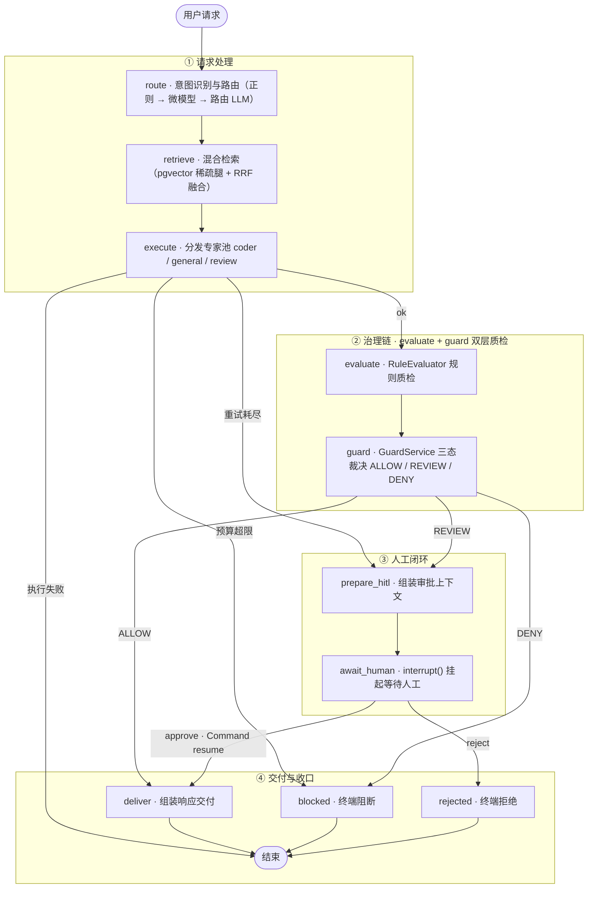

<div align="center">

# MoA Gateway
### 可验证的 AI 工程：LLM 治理运行时 + 多智能体实验台

仓库名保留历史写法（`Gateway` / `MoA` 两个词在正文口径里停用，理由见下）。项目本身是**一层 LLM 治理运行时**（`app/`）加**一个等预算的多智能体实验台**（`bench/`）；开发辅助（改 bug、审 PR）是任务载体，不是产品定位。

[](https://www.python.org/)
[](https://fastapi.tiangolo.com/)
[](https://github.com/langchain-ai/langgraph)
[](https://redis.io/)
[](https://github.com/pgvector/pgvector)
[](https://www.elastic.co/elasticsearch)
<br>
[](https://github.com/shing26/moa-gateway/actions/workflows/ci.yml)
[](https://github.com/astral-sh/ruff)
[](https://github.com/PyCQA/bandit)

<p align="center">
自动化测试门禁 · <b>28</b> 份 ADR · <b>23</b> 条 gold set · <b>10</b> 节点拓扑 · <b>4</b> 条零网络演示 · <b>6</b> 维离线评测
</p>

<p align="center">
  <a href="#-核心工程防线">核心工程防线</a> •
  <a href="#-真实节点拓扑">节点拓扑</a> •
  <a href="#-多智能体剂量实验台bench">剂量实验台</a> •
  <a href="#-秒级实测零网络依赖">秒级实测</a> •
  <a href="#-本地运行">本地运行</a> •
  <a href="#-项目结构概览">项目结构</a> •
  <a href="#-核心架构决策记录-adr">架构决策 (ADR)</a> •
  <a href="#-口径与边界">口径与边界</a>
</p>

</div>

> [!NOTE]
> **这是什么、不是什么**：
> 这个项目是**一层 LLM 治理运行时**（`app/`：拦截、审批、留痕、回归）加**一个等预算的多智能体实验台**（`bench/`：同一任务集、同一预算下把 agent 结构从 L0 加到 L3，看边际收益）。
> 三个词在这里**停用**：
> - **网关**——设计文档 §2.1 判定不成立：请求进来之后是它在干活，不是转发给别人、也不替谁挡流量。"网关"会让人以为它只是中间层。仓库名是历史遗留。
> - **多智能体系统**——PR 审查 R0 是 5 段顺序 LLM 调用；R1 再加入逐 finding 的 Critic，并把 `revise` 的一次回边送回 Report。它不是无边界 handoff 或并行调度。真有多个执行体并发分工的只有两处，且都不在产品主路径上：`app/orchestration/collaboration.py`（Supervisor + `Send` 扇出，`COLLAB_ENABLED=false`，显式入口，ADR-022）与 `bench/` 的剂量实验（L0–L3，人工跑，不进 CI，ADR-023）。
> - **开发辅助类 Agent**——改 bug / 审 PR 是**任务载体**，它们的价值是给治理层和实验台提供真实负载，不是要做成产品。
>
> 对外一句话：**"我建了个实验台，测出多智能体协作在编码任务上的边际收益在第几档转负——并且我能证明我的 agent 没有在撒谎。"**

---

## 💡 这个项目在接哪些坑？

多数 Demo 级 Agent 系统停留在 Prompt 串联或单向 ReAct 循环中，落地时极易撞上三个瓶颈：

1. **状态黑盒与无限震荡**：缺乏严格的状态机约束，反思逻辑陷入死循环或 Token 跑飞。
2. **协议虚假成功**：`SubAgent` 协议只有一个字符串出口（`execute() -> str`），失败与成功共用同一条通道——专家因环境缺失（如 `GITHUB_TOKEN` 未配置）把失败当答案返回时，下游会把它当正常内容放行（本仓实测出现过：Critic 甚至 approve 之后原样交付）。
3. **技术盲目堆砌**：缺乏量化评测体系，盲目引入 Rerank 等模块，在特征同源时导致排序指标（nDCG）负向倒退。

前两条构成 `app/`（治理运行时）的存在理由。第三条之外还有更根本的一问：**把这些都做对之后，多智能体到底值不值得？** 这是一个还没有答案的实验问题，由 `bench/` 用等预算的 L0–L3 剂量实验正面回答，而不是靠架构图宣称。

---

## 🛡️ 核心工程防线

### 1. 双运行时（Dual-Runtime）等价性架构

* **主路径轻量自研 FSM**：生产请求主干（`app/pipeline.py` + `app/fsm/state_machine.py`）运行在零外部编排框架依赖的自建有限状态机上（8 态全覆盖，重试预算由状态机结构决定）。状态转移表是全仓库唯一权威——图运行时试图走非法迁移会直接抛 `InvalidStateTransitionException`。
* **LangGraph 对照适配器**：`app/orchestration/graph.py`（ADR-008）把同一条请求链表达成 `StateGraph`，与 FSM 管道共用同一批协作者对象；`test_langgraph_adapter.py` 的协作者表面漂移门禁 + `test_engine_parity_golden.py` 的三个确定性场景逐字段对拍，严防引擎间的行为漂移。LangGraph 是独立可选 extra（`uv sync --extra langgraph`），默认不参与运行时。

### 2. 治理之下的专家分工与并发调度

* **受控意图路由**：`route` 节点完成意图解析（正则 → 微模型 → 路由 LLM 三级降级），`execute` 节点把任务分发至专家池（`coder` / `general` / `review`，复用 `AGENT_REGISTRY`，不引入新的 Agent 实现）。
* **Send 扇出与依赖波次**（`app/orchestration/collaboration.py`，ADR-022）：Supervisor 规划后，`dispatch` 只派 `depends_on` 已完成的 ready 子任务；同层 `execute_expert` 在同一 superstep 并发执行，完成后回到 `dispatch` 解锁下一层 → Critic 反思 → **有界** revise 回边（`COLLAB_MAX_ROUNDS=2` / `COLLAB_MAX_SUBTASKS=4`）→ 汇总后汇入同一条 guard/HITL/审计链。
* **并发写收敛至单点裁决**：`status` / `raw_output` 等 LastValue 通道被多个 worker 并发写会直接 `InvalidUpdateError`（第一版实测正是这么崩的）。现在并发 worker 只碰带 reducer 的通道（`failure_reasons` / `outputs` / `completed_round`），"是否升级、升成什么"由下游单个节点裁决；Critic 打回会重跑 `targets` 及其全部下游，无关分支保留。
* **业务专家可用工作区工具**：显式提供 `workspace_path` 与固定 `verify_command` 后，`coder` / `general` 获得 `read_file` / `write_file` / `list_files` / `search` / `run_tests`；宿主边界由 `COLLAB_WORKSPACE_ROOT` 决定，模型侧仍只能访问工作区内相对路径。
* **默认关闭、显式入口**：`COLLAB_ENABLED=false`，不进意图路由；入口是 `POST /api/v1/collab`、`python -m app.cli collab` 与演示脚本。协作挂起活在 LangGraph checkpoint，由 `resume()` 放行（飞书卡片回调不服务协作）。

### 3. Evaluate + Guard 双层运行时防御与 HITL

* **双层内容质检**：专家执行结果依次经过 `evaluate` 节点（`RuleEvaluator` 规则与格式审查）与 `guard` 节点（`GuardService` 策略 / 预算 / 三态裁决：ALLOW / REVIEW / DENY）。三级守卫优先级只有一份定义（`_merge_guard`），两条引擎共用，不会分叉。
* **原生断点人工介入（HITL）**：需审核任务流转至 `prepare_hitl` 与 `await_human` 节点——图路径用 LangGraph `interrupt()` 原语安全挂起、`Command(resume=...)` 恢复；生产审批走飞书回调驱动 FSM，挂起记录原子认领（`pop_hitl`：GETDEL → Lua 兜底），连点两次或并发回调只有一个生效。审批人白名单、申请人、审批原因全程进审计。
* **非对称失败防御（失败信封识别）**：`SubAgent` 协议失败与成功共用一个字符串出口，识别规则因此**刻意收窄**到三类不可能出自正常回答的形状——我们自己的失败文案、整条输出是一条异常（异常前缀只认**首行**，讨论 `ValueError` 的正常回答不误伤）、"缺一个形如凭据的标识符"且要求去配置它。误杀的代价（把好答案提前送进人工复核）远高于漏认；认出的失败直接升级人工，不流进评审、不伪装成成功交付。

### 4. 数据度量驱动的 RAG 架构止损

* **度量基准在先**：固定语料（6 篇项目文档 → 12 chunk）+ **23 条人工抽检** gold set（两阶段标注：独立模型生成候选 → 人工逐条确认；标注者与分块器作者不是同一人，来源与时间记在 `retrieval_gold.meta.json`），离线计算 Hit@1/3/5、Recall@5、MRR、nDCG@5。
* **同源特征归因与止损**：实测 base vs 纯词法精排器，六项 delta **无一为正**（Hit@1 `-0.087`、MRR `-0.0362`、nDCG@5 `-0.0356`，其余为 0）；23 条 query 中 **2 条 Top-1 由对变错、0 条由错变对**。覆盖率信号与稀疏腿高度同源，它只是在同一批候选里换了个排法——这个结果证明的是"度量能跑通、能分辨正负"，不是"精排有用"。
* **默认关闭 + 严格准入门禁**：按"先度量、后优化"的触发线实施 `RERANK_ENABLED=false`，重开条件写死在 `docs/retrieval-evaluation.md`：换不同源的信号（cross-encoder）、召回不再是瓶颈（当前 Recall@5=0.8478，说明有 chunk 根本没进候选集）、≥100 条 gold set 且有第二位标注者独立抽检、nDCG@5 与 MRR 同时为正。

### 5. 全链路审计与零成本 CI 确定性测试

* **全生命周期记账**：共享 `trace_id` 经 ContextVar 贯穿路由、执行、质检全流程，协作层自身的 Token 与延迟也纳管记账；`budget_guard` 会话级成本熔断（`BUDGET_SESSION_LIMIT_USD`）；审计 WAL 写成链（`prev_hash` / `entry_hash`，能指出第一个被改过的行号——tamper-evident，不是 tamper-proof）。
* **离线确定性保障**：Mock 协作 / 任务 LLM 与真机调合同构，CI 在 100% 零网络、零 Token 消耗下完成拓扑、流式链路与存储契约验证；具体测试数由当次 `pytest` 输出为准，不在 README 固化易漂移的数字。

---

## 🧭 真实节点拓扑

默认运行时是自建 FSM，会话状态为 `INIT → ROUTED → EXECUTING → OUTPUT_READY → COMPLETED`（失败走 `RETRY → SUSPENDED`，审批拒绝到 `REJECTED`）。下面是把**同一条请求链**表达为 LangGraph `StateGraph` 的 10 节点图（ADR-008，与 FSM 逐字段对拍）：



多 Agent 协作线（ADR-022）是**另一张**真实运行的图，默认关闭、显式入口：

```text
plan ──▶ dispatch ──▶ Send 派 ready 子任务 ──▶ execute_expert ×N ──▶ dispatch
             ▲                                                    │
             └────────────────────────────────────────────────────┘
                 同层 execute_expert 并发执行；所有依赖层完成后才进 critic
                 revise 会重跑 targets 及其全部下游（有界 COLLAB_MAX_ROUNDS=2），
                 无关分支的产出保留

之后汇入同一条治理链：evaluate ──▶ guard ──▶ prepare_hitl ──▶ await_human ──▶ deliver
收口节点：blocked / rejected / failed
```

---

## 🧪 多智能体剂量实验台（bench/）

`bench/` 是仓库的第二个主体。它把"多智能体到底强不强"当成一个**可证伪的实验问题**：同一任务集、同一 token 预算、同一中档模型，只改编排拓扑，看通过率与成本的边际变化。

| 档 | 编排（唯一变量） | 说明 |
| :---: | :--- | :--- |
| **L0** | 单 agent 循环 | 零点，与其余三档共用同一套工具 / 指令 / 判停条件 |
| **L1** | L0 + 一条**有界** Critic 回边 | worker 自报完成后由 `review` 专家复核，打回就按指令再改 |
| **L2** | Planner + 1 worker + Critic | 先分解成带上下文的子任务，再逐个交接执行、复核 |
| **L3** | L2 + N 并发 worker | 扇出执行、reducer 合并、按子任务重跑 |

- **判决不由执行体自报**：agent 交 `AgentRun`（它认为自己做了什么、为什么停下），harness 交 `RunResult`（它到底过没过）——两套类型分开，patch 由 harness 采集（`bench/agent/types.py`、ADR-023）。
- **能失败**：任务先跑一次 fail-first（基线必须红），agent 跑完再由固定验证命令判决；`fail` / `budget_exhausted` / `error` 是三种不同的结局，不当成同一种东西。
- **防作弊靠还原**：验证前把测试文件还原到任务定义的 test patch 版本，并删掉 `tests/` 下新增的未跟踪文件。

### 可验证实验台（Experiment Bench）

剂量曲线之外，`bench/experiment/` 把每次执行统一落成
`Experiment → Trial → Run Record`：任务、模型与配置快照、真实 prompt 指纹、计划与依赖、
Critic/Guard/HITL 结果、token/成本/工具账本、工作区执行前后指纹都在同一条记录里。
每条 Trial 独立写本地不可变 JSON，重复 Experiment ID 或覆盖旧 Trial 会直接失败。

```powershell
$verify = @("python", "-m", "pytest", "-q") | ConvertTo-Json -Compress
.\.venv\Scripts\python.exe bench/run_experiment.py collab `
  --task "读取 README.md 并总结" --mode mock --workspace . `
  --verify-command-json $verify --out .bench-experiments/readme-check
```

本地真模型用 `--mode live --provider local --model qwen2.5:3b`；受控复跑传
`--compare-to <baseline>/experiment.json`。完整 schema、比较语义与适配器边界见
[multi-agent-experiment-bench.md](docs/multi-agent-experiment-bench.md)。

"可验证"指机制（不可变 Run Record、预注册分析、全量对账）可被任何人复跑检查，
不等于结论已在多配置下验证：正式批次结论目前只覆盖两个本地模型配置
（v5/v8 均为 qwen2.5:3b，差异在 temperature 与单次输出上限），NVIDIA 端点
批次因容量阻塞未形成可分析样本，跨模型报告固定为描述性并列、不作推断。

### 第一轮真实曲线（2026-10-19）

模型 `nvidia/nemotron-3-super-120b-a12b`（免费端点，`temperature=1.0`），2 题 × 4 档 × 1 次：

| 档 | 通过率 | 平均 token | 平均每 pass token |
| :---: | ---: | ---: | ---: |
| L0 | 50% | 165,071 | 330,141 |
| **L1** | **100%** | 248,192 | 248,192 |
| L2 | 50%（1 条撞预算） | 371,190 | 742,380 |
| L3 | 50% | 217,867 | 435,733 |

边际：**L0→L1 +50pp / +83k token；L1→L2 −50pp / +123k；L2→L3 +0pp / −153k。**
读法是"**L1 是峰值**"：同样的模型、同样的题，只加一条 Critic 回边就把其中一题从 fail 翻成 pass；再往上加 planner（L2）成本涨了、通过率反而掉回来。L3 的 token 比 L2 低，是因为它把活分给并发 worker，但通过率没比 L2 更好。

> [!IMPORTANT]
> **这是方向性证据，不是统计结论**：`repeats=1`（报告里每个格子都标 `under_sampled`）、只有 2 题。单个 pass/fail 翻转就足以改变任何一列。

复现：`uv run python bench/run_curve.py --tasks 988fccb a746b81 --repeats 3`（**真花钱、不进 CI**），归档在 `.bench-work/`（不入库）。

### 正式批次结论（结论日期 2026-10-24）

**口径**：v5 B1（采集 2026-10-23）授权分析 + v5/v8 B1/B3 四批次
（2026-10-23 至 2026-10-24）384 条 Run Record 全量对账。
只有 v5 B1 满足 `analysis_authorized=true`；v8 B1 被 L3 有效样本门禁挡住，
v8 B3 存在 17 个截断 `error`。四批次全部对账通过，但对账 ≠ 授权分析。

| 批次 | 结论 | L0 token | L2 token | L3 token |
| :--- | :--- | ---: | ---: | ---: |
| v5 B1（授权分析） | 四 arm 通过率均 0%，L3−L0 配对差 0.0，p=1.0 | 67,884 | 705,993 | 538,632 |
| v8 B1 | 不可授权分析；L0 通过率 0% | 95,582 | 1,410,024 | 705,529 |

**读法必须精确**：L0 通过率本身为 0%，所以"配对差 0.0"不能解读为
"多智能体无增益"，只能解读为"当前模型与任务集下基线贴地板，增益不可测量"。
不受地板效应污染的硬数字是 token 倍率：L2/L3 相对 L0 消耗 **7.9–14.8 倍**。
**0 可测增益 × 8–15 倍成本**，是协作默认关闭的直接依据；默认开启的前提是
基线通过率脱离地板后，新批次给出配对检验显著为正。

这条教训已固化为 pilot 区分度门禁（`scripts/verify_pilot_runtime.py`）：
正式批次授权前，基线 arm 必须有足够有效样本且通过率不得贴 0%/100%；
落在 20%–80% 建议区间外会产生功效警告。v8 当年的 pilot 只有 1 条 L0
样本且全 fail，若该门禁当时存在，正式批次会在授权阶段被挡下，而不是
跑满 96 条后才发现数据没有区分力。

### 第二任务域：Issue 分诊（2026-10-25 收口）

分诊轨道复用同一条 pilot 门禁与 Run Record 契约，任务判定为 category+route
全对（priority 仅记录）。三轮 pilot 各拦截一个根因（workspace 空转 → 判定口径
含主观字段 → L2 planner 结构性失败），第四轮按 runbook 处置方向 2 冻结
**v3 L0-only 协议**（`scope.multi_arm_comparison=false`，无比较对象时
`analysis_authorized=false` 是正确输出）：

- pilot `issue-triage-v3-l0-pilot-live-r2`：基线 37.5%，门禁 `ready=true`；
- formal `issue-triage-v3-l0-formal-b1-live-r1`：24/24、0 error、全量对账通过，
  **L0 通过率 25%**，平均 1,938.7 token/次；逐字段归因 category 83.3% / route 37.5%，
  失败集中在 route 误路由 human。

读法：这是**方法迁移与基线建立**，不是分诊能力宣称——25% 只属于
qwen2.5:3b + 512 这一配置。多档重进须新协议重过门禁；主线编码任务的多智能体
结论以 v5 B1 授权分析为终稿，不再用当前配置追加批次。

---

## ⚡ 秒级实测（零网络依赖）

以下四条命令全部在本机实测可跑：mock / 确定性模式，不依赖外部 API Key 与外部网络，单条约 3–8 秒（含启动开销）。

```bash
# 1. 默认流式协作演示（Supervisor 规划 → Send 扇出并发执行 → Critic 放行 → 治理链 → 交付）
uv run python scripts/run_collaboration.py

# 2. 靶向回边重跑演示（Critic 打回 targets=[0] → 只重跑该子任务 → 第二轮 APPROVED 放行）
uv run python scripts/run_collaboration.py --scripted-revise

# 3. 失败信封演示（专家把失败当答案返回 → 评审前识别 → 直接升级人工，不伪装成功）
uv run python scripts/run_collaboration.py --scripted-failure

# 4. RAG 精排负向退化案例（同一 query 精排关/开 Top-k 并排对照，带 gold 标注）
uv run python scripts/rag_case.py
```

---

## 🚀 本地运行

```bash
python -m venv .venv
.venv\Scripts\activate        # Windows；Linux / macOS: source .venv/bin/activate

pip install uv
uv sync --all-extras --dev      # 已含 langgraph extra（协作链路需要；只跑主链路可不装）

cp .env.template .env           # 填入真实配置（留空也能跑离线演示与单测）
uv run python scripts/doctor.py # 环境诊断：Python / .env / 端口 / Redis / Ollama / pgvector
.venv\Scripts\python.exe -m app --port 8081
```

> [!TIP]
> **Windows 用户**：请用 `python -m app` 启动（而不是直接 `uvicorn`）——它会在 Uvicorn 建 loop 前切换到 Selector 事件循环，psycopg 的异步 pgvector 连接池需要它。

- 持久化依赖用仓库 Compose 起：`docker compose -f docker-compose.dev.yml up -d redis postgres`（Redis `6380` / pgvector `5433` / 应用 `8081`，避开常用端口）。
- 演示前一键起停：`powershell -ExecutionPolicy Bypass -File scripts\start_stack.ps1`（按序拉起容器 → Ollama → 应用，等 `/healthz` 通过）。
- 访问入口：`/dashboard`（管理后台）、`/dashboard/chat`（自主任务对话）、`/health` 与 `/healthz`（健康检查）。

---

## 📂 项目结构概览

```text
moa-gateway/
├── app/
│   ├── agent_core/       # ReAct 执行循环、工具契约与 Mock/LiteLLM 运行时
│   ├── agents/           # 专家契约、注册表、意图映射与请求级重试（coder / general / review）
│   ├── audit/            # WAL 审计链（prev_hash / entry_hash）+ Elasticsearch 异步持久化
│   ├── budget/           # 会话级 Token 与成本熔断（guard.py）
│   ├── engine.py         # 会话 FSM 引擎（HITL 挂起与审批状态）
│   ├── evaluator/        # RuleEvaluator 内容规则质检（判定接刹车）
│   ├── fsm/              # 状态转移表（8 态，唯一权威）
│   ├── guard/            # GuardService 三态裁决、RBAC、红队引擎
│   ├── orchestration/
│   │   ├── graph.py          # ADR-008：请求链的 LangGraph 表达（等价性对拍）
│   │   └── collaboration.py # ADR-022：多 Agent 协作图（默认关闭）
│   ├── pipeline.py       # 生产主链路：自建 FSM 管道
│   ├── router/           # 意图路由三级降级（正则 → 微模型 → 路由 LLM）
│   ├── routes/           # FastAPI 端点：chat / webhook / feishu / dashboard / collab
│   └── vectordb/         # pgvector 双腿检索（稀疏 + 稠密，RRF 融合）与 rerank 接入点
├── apps/
│   └── code_review_pipeline/   # PR 审查垂直应用 + ADR-021 经审批合并通道
├── bench/       # §5.0 agent 原语 + §5.1 带工具专家 + harness + 预算 B1/B3 + 报告聚合 + 任务定义（剂量曲线实验）
├── delivery/    # 定位与减法清单（对外口径的单一来源）+ 交付材料摘要
├── docs/
│   ├── adr/                           # ADR-002 ~ ADR-029
│   ├── archive/                       # 历史文档 9 份（未按此实施，见 archive/README.md）
│   ├── multi-agent-collaboration.md # 协作链路架构与并发写治理说明
│   ├── multi-agent-experiment-bench.md # Experiment/Trial/Run Record 契约与复跑语义
│   └── retrieval-evaluation.md      # 检索 gold set、度量基线与精排止损归档
├── evals/       # 数据集与 run_evals.py（intent / guard / e2e / retrieval / hitl_feedback）
├── scripts/     # 演示与验收：run_collaboration / rag_case / compare_rerank / doctor / redteam …
└── tests/       # 单元、契约、双引擎 Parity 与外部存储集成测试
```

---

## 📑 核心架构决策记录 (ADR)

项目所有核心演化遵循「决策先行、代码在后」原则，完整归档于 `docs/adr/`（adr-002 ~ adr-029）：

| ADR 编号 | 核心决策主题 | 关键设计与约束 |
| :---: | :--- | :--- |
| **ADR-002** | RBAC 与运行时 Guard | 定义三态（ALLOW / REVIEW / DENY）安全阻断模型 |
| **ADR-008** | LangGraph 第二引擎引入 | 主干采用自研 FSM；LangGraph 仅作等价性对照适配器（可选 extra） |
| **ADR-009** | 错误契约与预算熔断 | 统一 `ErrorCode` 分类学，会话级强制实施成本截断 |
| **ADR-010** | 请求生命周期与重试 | FSM 8 态全覆盖；重试预算由状态机结构决定（`RETRY_BUDGET=1`）；评估器判定接刹车 |
| **ADR-016** | 剩余台账与触发线管理 | 确立"先度量基线、后实施优化"：精排 / 换嵌入模型 / 分块升级各有触发线 |
| **ADR-019** | 审计链与保留 | WAL 哈希链（tamper-evident）；审计字段单一来源 |
| **ADR-020** | 混合检索落地 | 独立稀疏腿 + RRF（k=60）+ 维度不符启动 fail-fast；精排登记回 ADR-016 台账 |
| **ADR-021** | 审批门禁的合并通道 | PR 合并必须过人工审批门，全程留痕（谁批的、批了什么、何时） |
| **ADR-022** | 多 Agent 协作立项 | 解除 R6 冻结：Supervisor + `Send` fan-out + Critic 有界回边；不进主路径、默认关闭、复用同一套治理原语 |
| **ADR-023** | bench 内的 agent 原语 | 工具+循环+目标+记忆+预算六要素齐备、**能失败**的执行体；自报（`AgentRun`）与判决（`RunResult`）分离；落 `bench/`、不动 `app/` |
| **ADR-024** | PR Review 价值闭环 | 候选与发布分离；逐条五态反馈；Run generation 隔离；Comment-only 人工写回与固定 `R0/R1/R1+I` 评测 |
| **ADR-025** | 多智能体实验 Run Record | 固定 `Experiment → Trial → Run Record`；每条 Trial 不可变落盘；真实 prompt 指纹、模型/配置/工作区快照与受控复跑比较共同构成验收面 |

---

## 🔀 垂直应用：PR 审查与合并门禁

`apps/code_review_pipeline/` 内置 GitHub PR 审查流水线：Triage → 静态分析 → 语义 RAG → 测试覆盖 → 汇总报告。默认配置再加一层 **Review L1**：Report 产出的候选 finding 先由 Critic 逐条 `keep / revise / drop`，`revise` 只允许一次回边，随后经过 evidence gate 才能进入人工逐条反馈。

> [!IMPORTANT]
> **口径说明**：这条链路仍是**人工审批的 PR 审查助手**，不是自动合并门禁，也不是完整的 L2/L3 多智能体网络。R1 的 Critic 是一条有界回边；合并审批是另一条独立通道。

- 入口：`POST /webhook/github/review`（GitHub webhook body）或指令 `/review` 后输入 `owner/repo#PR号`；无 `GITHUB_TOKEN` 时优雅降级，不崩溃。
- 报告阶段出现 `critical` / `high` 发现，或 `medium` 发现 ≥3 条，或任一审查器返回无法解析的内容，即 `overall_need_human_review=True`，落库并进飞书卡片（2026-10-12 修复：此前该标记恒为 `False`，回归测试见 `tests/unit/test_review_hitl_escalation.py`）。
- **合并是独立的经审批通道**（ADR-021，`CODE_REVIEW_MERGE_ENABLED=1`）：CI 绿 → 飞书弹审批卡片 → 人点批准 → 运行时合并 → 审计。合并必须过审批门，全程留痕。
- 审查 finding 以候选、最终发布、Critic 丢弃和 superseded 状态落库；飞书逐条卡固定提供 `accepted_actionable` / `accepted_non_actionable` / `false_positive` / `duplicate` / `already_known` 五态。所有 finding 完成人工标注后，审批卡才允许写回 GitHub；写回固定为 `COMMENT`，不会自动批准或合并。
- 固定评测语料、R0/R1/R1+I runner 与报告器见 [review-value-loop.md](docs/review-value-loop.md) 与 [review_pr_corpus.json](evals/datasets/review_pr_corpus.json)。当前尚未产生质量结论；这些离线历史样本也不是持续用户规模。

---

## 🧪 质量保障与门禁

```bash
pytest tests/unit -q                          # 零网络零 token；以本地实际收集结果为准
ruff check .                                  # 代码风格
bandit -r app -q -s B105,B107,B110,B112,B324  # 安全扫描
python evals/run_evals.py --offline           # e2e 真跑业务链路（真 pipeline + 正则路由 + mock agent）
python bench/run_experiment.py collab --task "读取 README.md" --mode mock --workspace .
python scripts/redteam/run_redteam.py         # 200 条对抗用例，零网络约 1 秒，CI 硬门禁
python scripts/compare_rerank.py              # 精排 off/on 前后对比（gold set 23 条）
```

GitHub Actions CI（Python 3.12）依次执行：pytest → ruff → 防源码补丁脚本 → bandit → eval offline → 红队基线 → 导入自检，全链路零网络；Docker 镜像（`python:3.12-slim` + uv）仅在打 tag 时构建。

---

## 📏 口径与边界

- **红队 100% 是防漂移不变量**：用例与策略正则出自同一设计者，100% 证明"没有漂移"，不是泛化能力的证据；它的作用是防回归。
- **意图 Eval 只测正则表**：50 条中 46 条（92%）正则直出、4 条落默认意图——该维度不注入 LLM，"默认值命中默认值"；模型兜底路径的稳定性由 `intent_consistency` 维度单独测（预热后 55/55 一致）。
- **e2e 的 `intent_match` 是"与数据集标签的偏离率"，不是路由准确率**；judge 均分随机器 / 模型变化，不写死数字。
- **HITL 不跨重启**：会话状态在进程内、挂起记录在 Redis，重启后未决审批按 ADR-012 惰性作废（审计 `hitl_expired`）并告知用户——这是有意为之，要么接外部状态存储，要么承认它只在进程生命周期内有效。
- **同会话是排队的，不是并行的**：`MoAPipeline.run` 整个请求生命周期独占该会话（先到先处理，跨会话完全并行）——同会话并发投喂过去会撞出 `invalid_state_transition` 500，现在改为排队。代价是同一会话里一条慢请求会挡住下一条（LLM 超时上限之内）；不限流的匿名请求共用同一把锁（ADR-016 §五）。
- **OTel 是预留接口，不是链路**：全仓只有 2 个 span、未声明 exporter 依赖，设了端点也只落到 console。
- **协作链路边界**（ADR-022）：不进意图路由、不驱动会话 FSM；checkpointer 默认是单机 SQLite（`COLLAB_CHECKPOINT_PATH`，显式注入其它实现或 `:memory:` 可覆盖），CLI 的 mock 快捷路径仍用进程内 `InMemorySaver`；`COLLAB_LLM=litellm` 解析失败会降级规则式 mock；`depends_on` 已按依赖波次真实调度，工作区工具必须显式配置 `COLLAB_WORKSPACE_ROOT`。
- **成本量化本地不可验**：`avg_cost_usd` 恒 0（本地 Ollama 不计费）；`hitl_feedback` 4 条全是本地模拟种子，介入率无统计意义。
- **评测没有"本次 vs 上次"的基线对比**：报告覆盖写且不入库，结论目前不回流到任何决策点——这是"改进闭环"缺失的如实记录。
- 更完整的边界与残留项见各 ADR 的「后果 / 残留」节与 `delivery/` 文档；所有密钥经环境变量注入，`.env` / `logs/` / `data/` / `evals/reports/` 不入库。

---

<div align="center">
<sub><b>Python 3.12 · FastAPI · LangGraph · Redis · pgvector · Elasticsearch · uv</b></sub>
<br>
<sub>本 README 的每个定量声明都可用上文命令在本地复现（bench 曲线那条真花钱） · 架构决策归档于 docs/adr/（28 份）</sub>
</div>
