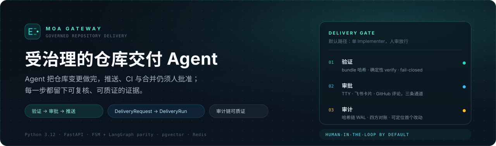
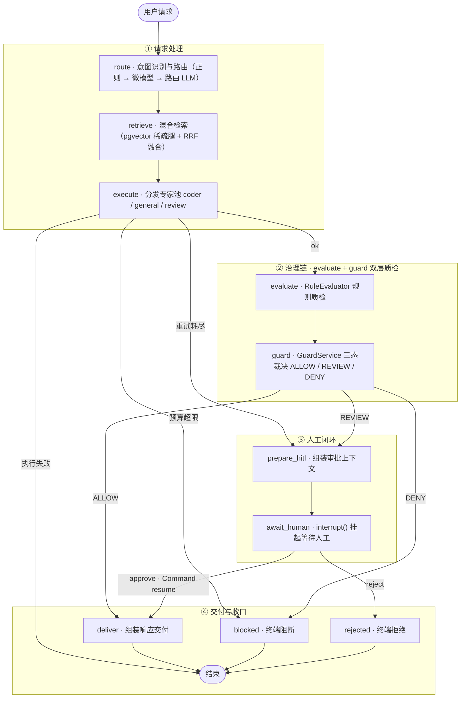

<div align="center">



# MoA Gateway

**受治理的仓库交付 Agent**

Agent 在隔离工作区里改代码、跑验证、产出可审批的 PR；推送、CI 与合并必须留下可复核证据并经过人批准。<br>S0 已实现，真实仓库端到端验收于 2026-10-30 完成；只读 Verifier 是预注册实验 S1，默认关闭。

[](https://www.python.org/) [](https://fastapi.tiangolo.com/) [](https://github.com/langchain-ai/langgraph) [](https://redis.io/) [](https://github.com/pgvector/pgvector) [](https://www.elastic.co/elasticsearch)

[](https://github.com/shing26/moa-gateway/actions/workflows/ci.yml) [](https://github.com/astral-sh/ruff) [](https://github.com/PyCQA/bandit)

<sub><b>42</b> 份 ADR · <b>23</b> 条 gold set · <b>10</b> 节点拓扑 · <b>4</b> 条零网络演示 · <b>6</b> 维离线评测 · 自动化测试门禁</sub>

<p align="center">
  <a href="#-60-秒上手"><b>60 秒上手</b></a> •
  <a href="#-一次真实交付的完整-trace2026-11-01">真实交付 trace</a> •
  <a href="#-关键词与证据索引">证据索引</a> •
  <a href="#-核心工程防线">工程防线</a> •
  <a href="#-真实节点拓扑">节点拓扑</a> •
  <a href="#-项目结构概览">项目结构</a> •
  <a href="#-核心架构决策记录-adr">架构决策 (ADR)</a> •
  <a href="#-口径与边界">口径与边界</a>
</p>

</div>

## 🚀 60 秒上手

```bash
# 1. 安装依赖（Python 3.12 + uv，首次约 1–3 分钟）
uv sync --all-extras --dev

# 2. 环境自检：Python / .env / 端口 / Redis / Ollama / pgvector
uv run python scripts/doctor.py

# 3. 启动（Windows；Linux / macOS 用 .venv/bin/python -m app）
.venv\Scripts\python.exe -m app --port 8081
```

没有 API Key 也能先看交付门禁——零网络、零 Token，约 8 秒：Agent 在临时仓库改代码 → 跑验证 → 产出变更包（dry-run，不触碰远端）：

```bash
uv run python scripts/run_change_demo.py          # 验证通过，产出变更包
uv run python scripts/run_change_demo.py --fail   # 验证失败，出口被挡住
```

完整步骤与端口说明见 [本地运行](#-本地运行)，四条零网络演示见 [零网络演示](#-零网络演示含已冻结实验)。

## 🧱 三层结构

| 层 | 它是什么 | 从这里进入 |
|---|---|---|
| **产品 · 交付 Agent** | `DeliveryRequest -> DeliveryRun`，默认单 Implementer，产出可审批的 PR | [受治理仓库交付 Agent](#受治理仓库交付-agent) |
| **支撑 · 治理运行时** | `app/`：FSM 主链、HITL、Guard、审计 WAL、检索与预算 | [核心工程防线](#-核心工程防线) |
| **附录 · 实验档案（已冻结）** | `bench/`：L0–L3 等预算实验的代码与 Run Record；结论已定稿，不再扩场景 | [实验档案](#-实验档案bench已冻结) |

> [!IMPORTANT]
> **先对齐口径——这不是网关，也不是多智能体编排演示，更不是自动合并。**
> - **网关**：请求进来后由它执行，不是转发层，也不替谁挡流量；仓库名是历史遗留。
> - **多智能体编排不是主线**：产品默认单 Implementer；协作图（`COLLAB_ENABLED=false`，ADR-022）与 `bench/` 剂量实验（人工跑、不进 CI，ADR-023）都已冻结，只作为历史实验保留。
> - **自动合并**：推送与合并必须过 bundle、人工审批与审计；CI 失败只做只读诊断并转人工，不自动修复。
>
> 对外一句话：**“我让 Agent 把仓库变更做完，但推送、CI 与合并都必须留下可复核证据并经过人批准。”**

<details>
<summary><b>展开：完整定位、停用词与当前边界</b></summary>

仓库名保留历史写法（`Gateway` / `MoA` 两个词在正文口径里停用，理由见下）。**产品是受治理的仓库交付 Agent**：入口为 `DeliveryRequest -> DeliveryRun`，默认单 Implementer，负责在隔离工作区中修改、验证并产出可审批的 PR；推送和合并仍必须经过 bundle、人工审批与审计。`app/` 是支撑交付链的 LLM 治理运行时；`bench/` 是已冻结的历史实验档案，不再是项目主线。S0 已实现，真实仓库端到端验收已于 2026-10-30 完成（证据见 `docs/acceptance/2026-10-30-s0-acceptance.md`）；只读 Verifier 是预注册实验 S1，默认关闭。

这个项目的**产品**是受治理的仓库交付 Agent；**支撑层**是 `app/` 的治理运行时（拦截、审批、留痕、回归）；`bench/` 是**历史实验档案**（同一任务集、同一预算下把 agent 结构从 L0 加到 L3 的等预算实验，2026-10 冻结）。三层不能倒过来读成“平台已经支撑多场景”。

这里**停用两个词**，并明确交付 Agent 的当前边界：

- **网关**——设计文档 §2.1 判定不成立：请求进来之后是它在干活，不是转发给别人、也不替谁挡流量。"网关"会让人以为它只是中间层。仓库名是历史遗留。
- **多智能体系统**——PR 审查 R0 是 5 段顺序 LLM 调用；R1 再加入逐 finding 的 Critic，并把 `revise` 的一次回边送回 Report。它不是无边界 handoff 或并行调度。真有多个执行体并发分工的只有两处，且都已冻结、不在产品主路径上：`app/orchestration/collaboration.py`（Supervisor + `Send` 扇出，`COLLAB_ENABLED=false`，ADR-022）与 `bench/` 的剂量实验（L0–L3，人工跑、不进 CI，ADR-023）。
- **交付 Agent**——默认是单 Implementer，负责改代码、验证、产出可审批的 PR；只读 Verifier 是预注册实验 S1，不是默认拓扑。CI 失败诊断是只读辅助入口，不是 CI 自动修复。

</details>

---

## 🔍 关键词与证据索引

面试与评审中最常被追问的关键词，每个都对应一个可点开的 artifact（主路径代码、ADR 或带四方对账的验收记录），不指向架构图或宣称：

| 关键词 | 可点开的证据 |
|---|---|
| **审批 · 人机协同** | 运行时 HITL 挂起-恢复与审批白名单：[ADR-021](docs/adr/adr-021-approval-gated-merge.md)、`app/pipeline.py` 的 `prepare_hitl` / `await_human`；合并门禁（head-SHA 乐观锁）：[`merge_executor.py`](apps/code_review_pipeline/merge_executor.py)；推送审批现支持 TTY（[`cli.py`](app/cli.py)）与飞书远程卡片（ADR-042）两条通道 `TerminalPushApprovalPort` |
| **审计 · 留痕** | 哈希链审计 WAL（tamper-evident，能指出第一个被改的行号）：[ADR-019](docs/adr/adr-019-audit-chain-and-retention.md)、[`app/audit/wal.py`](app/audit/wal.py)；GitHub / DeliveryRun / MergeRecord / 审计 WAL 四方对账实例：[S0 真实验收记录](docs/acceptance/2026-10-30-s0-acceptance.md) |
| **评测 · 效果度量** | RAG 六维离线评测与同源特征止损（实测 nDCG 负向倒退即关闭）：[docs/retrieval-evaluation.md](docs/retrieval-evaluation.md)；预注册配对分析协议：[ADR-029](docs/adr/adr-029-preregistered-paired-analysis.md) |
| **实验归档（已冻结）** | 实验协议与运行记录：[ADR-026](docs/adr/adr-026-experiment-protocol.md)、[ADR-025](docs/adr/adr-025-multi-agent-experiment-run-record.md)；等预算剂量设计：[ADR-023](docs/adr/adr-023-bench-agent-primitive.md)；结论：[实验档案](docs/multi-agent-experiment-conclusions.md) |
| **交付门禁 · 写侧安全** | bundle 审批边界与确定性验证：[ADR-030](docs/adr/adr-030-governed-change-agent.md)、[`bundle.py`](apps/code_review_pipeline/change/bundle.py)；交付 Agent 全链路：[ADR-031](docs/adr/adr-031-governed-repository-delivery-agent.md)；工作区写隔离：[ADR-027](docs/adr/adr-027-workspace-write-isolation.md)；S1 数据门槛（dogfood 先行）：[ADR-033](docs/adr/adr-033-s1-data-gate-dogfood-first.md) |
| **凭证 · 脱敏** | 纵深凭证防线：输入侧白名单（[`subprocess_env.py`](app/agents/subprocess_env.py)）+ 输出侧统一 `redact()`（[ADR-035](docs/adr/adr-035-output-redaction.md)、[`app/redact.py`](app/redact.py)）；触发层四契约预注册：[ADR-036](docs/adr/adr-036-trigger-layer-preregistration.md)；同类产品对照与取舍：[docs/competitive-analysis.md](docs/competitive-analysis.md) |
| **上下文 · 记忆** | 会话记忆与预算：[`app/memory.py`](app/memory.py)、[`app/context_budget.py`](app/context_budget.py)；长期记忆：[`app/long_term_memory.py`](app/long_term_memory.py)；知识库访问控制：[`app/knowledge_access.py`](app/knowledge_access.py) |

---

## 🧬 一次真实交付的完整 trace（2026-11-01）

治理系统治理它自己的开发。下面不是示意图，是 dogfood 第 1 个交付的原始时间线，
每一环都可点开质证（[issue #24](https://github.com/shing26/moa-gateway/issues/24) /
[PR #25](https://github.com/shing26/moa-gateway/pull/25) / [台账](docs/acceptance/dogfood-ledger.md)）：

1. **发现**：agent 现场查证 `gh api` 得到 `Branch not protected`——README 宣称的
   "每次合并过审批门"在平台层不存在。goal 先于开工记录为 issue #24（时间戳可证）。
2. **执行**：给 main 装分支保护（required check + enforce_admins + 禁 force push）。
3. **门禁第一次咬人**：CI 全绿但合并 BLOCKED，required check 永远 "Expected"。
4. **两层根因**：`ci.yml` 头部 UTF-8 BOM 使 workflow 名解析失效；修掉后仍 BLOCKED——
   第二层是 required check 条目 `app_id: null` 时 GitHub 纯字符串比对 context 名，
   UI 显示的 `工作流/job` 形式与实际裸 job 名永不匹配。最终生效配置：
   裸 job 名 + 绑定 GitHub Actions 应用（app_id 15368）。
5. **收口**：修复与 ADR-034 经同一条 PR（#25）走新门禁 → CLEAN → 人工合并；
   台账第 1 行入账，预注册修正案（累计计数、goal 先行）在首个数据点前落盘。

这条 trace 里最有价值的两点：**门禁上线 24 小时内挡住了第一次合并**——挡的是
自己的交付，但"平台层门禁真的会咬人"从此是实证不是宣称；**验证流程把自己的
首次误判也如实更正了**（issue #24 里先归因 BOM、后补正根因链的两条评论）——
可质证的对象包括质证者自己。

---

## 💡 这个项目在接哪些坑？

多数 Demo 级 Agent 系统停留在 Prompt 串联或单向 ReAct 循环中，落地时极易撞上三个瓶颈：

1. **状态黑盒与无限震荡**：缺乏严格的状态机约束，反思逻辑陷入死循环或 Token 跑飞。
2. **协议虚假成功**：`SubAgent` 协议只有一个字符串出口（`execute() -> str`），失败与成功共用同一条通道——专家因环境缺失（如 `GITHUB_TOKEN` 未配置）把失败当答案返回时，下游会把它当正常内容放行（本仓实测出现过：Critic 甚至 approve 之后原样交付）。
3. **技术盲目堆砌**：缺乏量化评测体系，盲目引入 Rerank 等模块，在特征同源时导致排序指标（nDCG）负向倒退。

前两条构成 `app/`（治理运行时）的存在理由。第三条曾被 `bench/` 用等预算实验正面回答过一次：**当前配置下多智能体增益不可测量、成本 7.9–14.8 倍**，因此协作默认关闭。这个否定性结论只对当时的模型与任务集成立，证据保留在实验档案中，不再作为项目主线扩展。

---

## 🛡️ 核心工程防线

### 1. 双运行时（Dual-Runtime）等价性架构

* **主路径轻量自研 FSM**：生产请求主干（`app/pipeline.py` + `app/fsm/state_machine.py`）运行在零外部编排框架依赖的自建有限状态机上（8 态全覆盖，重试预算由状态机结构决定）。状态转移表是全仓库唯一权威——图运行时试图走非法迁移会直接抛 `InvalidStateTransitionException`。
* **LangGraph 对照适配器**：`app/orchestration/graph.py`（ADR-008）把同一条请求链表达成 `StateGraph`，与 FSM 管道共用同一批协作者对象；`test_langgraph_adapter.py` 的协作者表面漂移门禁 + `test_engine_parity_golden.py` 的三个确定性场景逐字段对拍，严防引擎间的行为漂移。LangGraph 是独立可选 extra（`uv sync --extra langgraph`），默认不参与运行时。

### 1b. 启动前 preflight verify 自检

交付启动前对配置里的 verify 命令做一次探测：命令超时或为空一律映射为 `blocked`，不让空配置伪装成已验证（2026-11-20 修复，PR #111）。这条是本地启动门，不替代 CI。

### 2. 治理之下的专家分工与并发调度

* **受控意图路由**：`route` 节点完成意图解析（正则 → 微模型 → 路由 LLM 三级降级），`execute` 节点把任务分发至专家池（`coder` / `general` / `review`，复用 `AGENT_REGISTRY`，不引入新的 Agent 实现）。
* **Send 扇出与依赖波次**（`app/orchestration/collaboration.py`，ADR-022）：Supervisor 规划后，`dispatch` 只派 `depends_on` 已完成的 ready 子任务；同层 `execute_expert` 在同一 superstep 并发执行，完成后回到 `dispatch` 解锁下一层 → Critic 反思 → **有界** revise 回边（`COLLAB_MAX_ROUNDS=2` / `COLLAB_MAX_SUBTASKS=4`）→ 汇总后汇入同一条 guard/HITL/审计链。
* **并发写收敛至单点裁决**：`status` / `raw_output` 等 LastValue 通道被多个 worker 并发写会直接 `InvalidUpdateError`（第一版实测正是这么崩的）。现在并发 worker 只碰带 reducer 的通道（`failure_reasons` / `outputs` / `completed_round`），"是否升级、升成什么"由下游单个节点裁决；Critic 打回会重跑 `targets` 及其全部下游，无关分支保留。
* **业务专家可用工作区工具**：显式提供 `workspace_path` 与固定 `verify_command` 后，`coder` / `general` 获得 `read_file` / `write_file` / `list_files` / `search` / `run_tests`；宿主边界由 `COLLAB_WORKSPACE_ROOT` 决定，模型侧仍只能访问工作区内相对路径。
* **默认关闭、显式入口**：`COLLAB_ENABLED=false`，不进意图路由；入口是 `POST /api/v1/collab`、`python -m app.cli collab` 与演示脚本。协作挂起活在 LangGraph checkpoint，由 `resume()` 放行（飞书卡片回调不服务协作）。

### 3. Evaluate + Guard 双层运行时防御与 HITL

* **双层内容质检**：专家执行结果依次经过 `evaluate` 节点（`RuleEvaluator` 规则与格式审查）与 `guard` 节点（`GuardService` 策略 / 预算 / 三态裁决：ALLOW / REVIEW / DENY）。三级守卫优先级只有一份定义（`_merge_guard`），两条引擎共用，不会分叉。
* **原生断点人工介入（HITL）**：需审核任务流转至 `prepare_hitl` 与 `await_human` 节点——图路径用 LangGraph `interrupt()` 原语安全挂起、`Command(resume=...)` 恢复；生产审批走飞书回调驱动 FSM，挂起记录原子认领（`pop_hitl`：GETDEL → Lua 兜底），连点两次或并发回调只有一个生效。审批人白名单、申请人、审批原因全程进审计。
* **非对称失败防御（失败信封识别）**：`SubAgent` 协议失败与成功共用一个字符串出口，识别规则因此**刻意收窄**到三类不可能出自正常回答的形状——我们自己的失败文案、整条输出是一条异常（异常前缀只认**首行**，讨论 `ValueError` 的正常回答不误伤）、"缺一个形如凭据的标识符"且要求去配置它。误杀的代价（把好答案提前送进人工复核）远高于漏认；认出的失败直接升级人工，不流进评审、不伪装成成功交付。

### 4. 数据度量驱动的 RAG 架构止损

* **度量基准在先**：固定语料（6 篇项目文档 → 12 chunk）+ **23 条人工抽检** gold set（两阶段标注：独立模型生成候选 → 人工逐条确认；标注者与分块器作者不是同一人，来源与时间记在 `retrieval_gold.meta.json`），离线计算 Hit@1/3/5、Recall@5、MRR、nDCG@5。
* **同源特征归因与止损**：实测 base vs 纯词法精排器，六项 delta **无一为正**（Hit@1 `-0.087`、MRR `-0.0362`、nDCG@5 `-0.0356`，其余为 0）；23 条 query 中 **2 条 Top-1 由对变错、0 条由错变对**。覆盖率信号与稀疏腿高度同源，它只是在同一批候选里换了个排法——这个结果证明的是"度量能跑通、能分辨正负"，不是"精排有用"。
* **默认关闭 + 严格准入门禁**：按"先度量、后优化"的触发线实施 `RERANK_ENABLED=false`，重开条件写死在 `docs/retrieval-evaluation.md`：换不同源的信号（cross-encoder）、召回不再是瓶颈（当前 Recall@5=0.8478，说明有 chunk 根本没进候选集）、≥100 条 gold set 且有第二位标注者独立抽检、nDCG@5 与 MRR 同时为正。

### 5. 全链路审计与零成本 CI 确定性测试

* **全生命周期记账**：共享 `trace_id` 经 ContextVar 贯穿路由、执行、质检全流程，协作层自身的 Token 与延迟也纳管记账；`budget_guard` 会话级成本熔断（`BUDGET_SESSION_LIMIT_USD`）；审计 WAL 写成链（`prev_hash` / `entry_hash`，能指出第一个被改过的行号——tamper-evident，不是 tamper-proof）；跨日按当日文件重恢复链头（2026-11-20 修复），不会因 rollover 断链。
* **离线确定性保障**：Mock 协作 / 任务 LLM 与真机调合同构，CI 在 100% 零网络、零 Token 消耗下完成拓扑、流式链路与存储契约验证；具体测试数由当次 `pytest` 输出为准，不在 README 固化易漂移的数字。

---

## 🧭 真实节点拓扑

默认运行时是自建 FSM，会话状态为 `INIT → ROUTED → EXECUTING → OUTPUT_READY → COMPLETED`（失败走 `RETRY → SUSPENDED`，审批拒绝到 `REJECTED`）。下面是把**同一条请求链**表达为 LangGraph `StateGraph` 的 10 节点图（ADR-008，与 FSM 逐字段对拍）：



<details>
<summary><b>已冻结：多 Agent 协作图（ADR-022，默认关闭，不在主路径）</b></summary>

```text
plan ──▶ dispatch ──▶ Send 派 ready 子任务 ──▶ execute_expert ×N ──▶ dispatch
             ▲                                                    │
             └────────────────────────────────────────────────────┘
                 同层 execute_expert 并发执行；所有依赖层完成后才进 critic
                 revise 会重跑 targets 及其全部下游（有界 COLLAB_MAX_ROUNDS=2），
                 无关分支的产出保留

之后汇入同一条治理链：evaluate ──▶ guard ──▶ prepare_hitl ──▶ await_human ──▶ deliver
收口节点：blocked / rejected / failed
```

</details>

---

## 🧪 实验档案（bench/，已冻结）

`bench/` 保留 2026-10 的等预算剂量实验，**不是产品主线，也不再扩场景**：同一任务集、同一 token 预算、同一模型，只改编排拓扑（L0–L3），用通过率与成本判断“加编排是否值得”。2026-10-25 之后未再开新批次，代码与 Run Record 保留用于复跑和质证。

| 档 | 编排（唯一变量） | 说明 |
| :---: | :--- | :--- |
| **L0** | 单 agent 循环 | 零点，与其余三档共用同一套工具 / 指令 / 判停条件 |
| **L1** | L0 + 一条**有界** Critic 回边 | worker 自报完成后由 `review` 专家复核，打回就按指令再改 |
| **L2** | Planner + 1 worker + Critic | 先分解成带上下文的子任务，再逐个交接执行、复核 |
| **L3** | L2 + N 并发 worker | 扇出执行、reducer 合并、按子任务重跑 |

- **判决不由执行体自报**：agent 交 `AgentRun`（它认为自己做了什么、为什么停下），harness 交 `RunResult`（它到底过没过）——两套类型分开，patch 由 harness 采集（`bench/agent/types.py`、ADR-023）。
- **能失败**：任务先跑一次 fail-first（基线必须红），agent 跑完再由固定验证命令判决；`fail` / `budget_exhausted` / `error` 是三种不同的结局，不当成同一种东西。
- **防作弊靠还原**：验证前把测试文件还原到任务定义的 test patch 版本，并删掉 `tests/` 下新增的未跟踪文件。

| 实验 | 结论 |
|---|---|
| v5 B1（唯一授权分析） | 四档通过率均 0%，L3−L0 配对差 0.0（p=1.0）；token 为 L0 的 **7.9–14.8 倍** → 基线贴地板，**增益不可测量且成本高** |
| v8 B1 | L0 通过率 0%，被有效样本门禁挡住，**不可授权分析** |
| 第一轮曲线（2026-10-19，n=2、repeats=1） | L1（单条有界 Critic 回边）为峰值：L0 50% → L1 100%；**方向性证据，不是统计结论** |
| Issue 分诊 v3 L0（2026-10-25） | 24/24、0 error、对账通过；L0 25%，仅属 qwen2.5:3b + 512 配置，**方法迁移，不是能力宣称** |

这条实验线的直接产出是一个否定性依据：**0 可测增益 × 8–15 倍成本**，所以协作图 `COLLAB_ENABLED=false`、不进主路径。方法（自报/判决分离、fail-first、防作弊还原、不可变 Run Record）仍被交付链复用。

完整曲线、四批次对账与分诊口径见 [multi-agent-experiment-conclusions.md](docs/multi-agent-experiment-conclusions.md)；机制契约见 [multi-agent-experiment-bench.md](docs/multi-agent-experiment-bench.md)。复跑：`uv run python bench/run_curve.py --tasks 988fccb a746b81 --repeats 3`（真花钱、不进 CI）。

---

## ⚡ 零网络演示（含已冻结实验）

以下四条命令全部在本机实测可跑：mock / 确定性模式，不依赖外部 API Key 与外部网络，单条约 3–8 秒（含启动开销）。

**前置（一次性）**：安装 [uv](https://docs.astral.sh/uv/) 后执行 `uv sync --all-extras --dev`——协作演示（1–3）硬依赖 `langgraph` optional extra，漏装会报 `ModuleNotFoundError`；第 4 条 RAG 案例不需要 extra。首次运行 uv 会自动安装依赖与 Python（约 1–3 分钟，之后才是秒级）。

> 1–3 是**已冻结的协作实验**，用于演示治理链与失败识别，不在产品主路径；日常交付走 `delivery` CLI。

```bash
# 1. 协作实验演示（需显式开启 COLLAB_ENABLED；Supervisor → Send 扇出 → Critic 放行 → 治理链）
uv run python scripts/run_collaboration.py

# 2. 靶向回边实验（Critic 打回 targets=[0] → 只重跑该子任务 → 第二轮 APPROVED；非默认交付路径）
uv run python scripts/run_collaboration.py --scripted-revise

# 3. 失败信封演示（专家把失败当答案返回 → 评审前识别 → 直接升级人工，不伪装成功）
uv run python scripts/run_collaboration.py --scripted-failure

# 4. RAG 精排负向退化案例（同一 query 精排关/开 Top-k 并排对照，带 gold 标注）
uv run python scripts/rag_case.py
```

---

## 🚀 本地运行

```bash
python -m venv .venv
.venv\Scripts\activate        # Windows；Linux / macOS: source .venv/bin/activate

pip install uv
uv sync --all-extras --dev      # 已含 langgraph extra（协作链路需要；只跑主链路可不装）

cp .env.template .env           # 填入真实配置（留空也能跑离线演示与单测）
uv run python scripts/doctor.py # 环境诊断：Python / .env / 端口 / Redis / Ollama / pgvector
.venv\Scripts\python.exe -m app --port 8081
```

> [!TIP]
> **Windows 用户**：请用 `python -m app` 启动（而不是直接 `uvicorn`）——它会在 Uvicorn 建 loop 前切换到 Selector 事件循环，psycopg 的异步 pgvector 连接池需要它。

- 持久化依赖用仓库 Compose 起：`docker compose -f docker-compose.dev.yml up -d redis postgres`（Redis `6380` / pgvector `5433` / 应用 `8081`，避开常用端口）。
- 演示前一键起停：`powershell -ExecutionPolicy Bypass -File scripts\start_stack.ps1`（按序拉起容器 → Ollama → 应用，等 `/healthz` 通过）。
- 访问入口：`/dashboard`（管理后台）、`/dashboard/chat`（自主任务对话）、`/health` 与 `/healthz`（健康检查）。

> [!TIP]
> **换目标仓库不改主配置**：`config/repos/<owner>/<repo>.toml` 保存单个目标仓库的知识配置（ADR-041）。

---

> **Dashboard 重设计预览**：`design-preview/` 下有 3 视图草案与 HANDOFF（2026-11-21 staged），仅设计稿，实现未开始，不代表当前可用能力。

## 📂 项目结构概览

```text
moa-gateway/
├── app/
│   ├── agent_core/       # ReAct 执行循环、工具契约与 Mock/LiteLLM 运行时
│   ├── agents/           # 专家契约、注册表、意图映射与请求级重试（coder / general / review）
│   ├── audit/            # WAL 审计链（prev_hash / entry_hash）+ Elasticsearch 异步持久化
│   ├── budget/           # 会话级 Token 与成本熔断（guard.py）
│   ├── engine.py         # 会话 FSM 引擎（HITL 挂起与审批状态）
│   ├── evaluator/        # RuleEvaluator 内容规则质检（判定接刹车）
│   ├── fsm/              # 状态转移表（8 态，唯一权威）
│   ├── guard/            # GuardService 三态裁决、RBAC、红队引擎
│   ├── orchestration/
│   │   ├── graph.py          # ADR-008：请求链的 LangGraph 表达（等价性对拍）
│   │   └── collaboration.py # ADR-022：多 Agent 协作图（已冻结，默认关闭）
│   ├── pipeline.py       # 生产主链路：自建 FSM 管道
│   ├── router/           # 意图路由三级降级（正则 → 微模型 → 路由 LLM）
│   ├── routes/           # FastAPI 端点：chat / webhook / feishu / dashboard / collab
│   └── vectordb/         # pgvector 双腿检索（稀疏 + 稠密，RRF 融合）与 rerank 接入点
├── apps/
│   └── code_review_pipeline/   # PR 审查垂直应用 + ADR-021 经审批合并通道
├── bench/       # 已冻结：agent 原语、harness、预算与 L0–L3 剂量实验（历史证据，不再扩场景）
├── delivery/    # 定位与减法清单（对外口径的单一来源）+ 交付材料摘要
├── docs/
│   ├── adr/                           # ADR-002 ~ ADR-043
│   ├── archive/                       # 历史文档 9 份（未按此实施，见 archive/README.md）
│   ├── multi-agent-collaboration.md # 协作链路架构与并发写治理说明
│   ├── multi-agent-experiment-bench.md # Experiment/Trial/Run Record 契约与复跑语义
│   ├── multi-agent-experiment-conclusions.md # 剂量实验结论归档（已冻结）
│   └── retrieval-evaluation.md      # 检索 gold set、度量基线与精排止损归档
├── evals/       # 数据集与 run_evals.py（intent / guard / e2e / retrieval / hitl_feedback）
├── scripts/     # 演示与验收：run_collaboration / rag_case / compare_rerank / doctor / redteam …
└── tests/       # 单元、契约、双引擎 Parity 与外部存储集成测试
```

---

## 📑 核心架构决策记录 (ADR)

项目所有核心演化遵循「决策先行、代码在后」原则，完整归档于 `docs/adr/`（adr-002 ~ adr-043）：

| ADR 编号 | 核心决策主题 | 关键设计与约束 |
| :---: | :--- | :--- |
| **ADR-002** | RBAC 与运行时 Guard | 定义三态（ALLOW / REVIEW / DENY）安全阻断模型 |
| **ADR-008** | LangGraph 第二引擎引入 | 主干采用自研 FSM；LangGraph 仅作等价性对照适配器（可选 extra） |
| **ADR-009** | 错误契约与预算熔断 | 统一 `ErrorCode` 分类学，会话级强制实施成本截断 |
| **ADR-010** | 请求生命周期与重试 | FSM 8 态全覆盖；重试预算由状态机结构决定（`RETRY_BUDGET=1`）；评估器判定接刹车 |
| **ADR-016** | 剩余台账与触发线管理 | 确立"先度量基线、后实施优化"：精排 / 换嵌入模型 / 分块升级各有触发线 |
| **ADR-019** | 审计链与保留 | WAL 哈希链（tamper-evident）；审计字段单一来源 |
| **ADR-020** | 混合检索落地 | 独立稀疏腿 + RRF（k=60）+ 维度不符启动 fail-fast；精排登记回 ADR-016 台账 |
| **ADR-021** | 审批门禁的合并通道 | PR 合并必须过人工审批门，全程留痕（谁批的、批了什么、何时） |
| **ADR-022** | 多 Agent 协作立项（已冻结） | Supervisor + `Send` fan-out + Critic 有界回边；不进主路径、默认关闭、复用同一套治理原语；2026-11-25 随主线收敛归档，不再扩展 |
| **ADR-023** | bench 内的 agent 原语 | 工具+循环+目标+记忆+预算六要素齐备、**能失败**的执行体；自报（`AgentRun`）与判决（`RunResult`）分离；落 `bench/`、不动 `app/` |
| **ADR-024** | PR Review 价值闭环 | 候选与发布分离；逐条五态反馈；Run generation 隔离；Comment-only 人工写回与固定 `R0/R1/R1+I` 评测 |
| **ADR-025** | 多智能体实验 Run Record（已冻结） | 固定 `Experiment → Trial → Run Record`；每条 Trial 不可变落盘；真实 prompt 指纹、模型/配置/工作区快照与受控复跑比较共同构成验收面；机制仍被复用，实验线不再扩场景 |
| **ADR-030** | 受治理的变更 agent | 验证 → 人工审批 → 推送；默认 dry-run，未验证或无模型时拒绝产出可推送变更包 |
| **ADR-031** | 受治理仓库交付 Agent | `DeliveryRequest -> DeliveryRun`；默认单 Implementer，Verifier 仅作预注册实验 |
| **ADR-032** | CI 失败只读诊断 | 只收集、脱敏并归类失败证据；不修复、不重跑、不写回 GitHub |

---

## 🔀 垂直应用：PR 审查与合并门禁

`apps/code_review_pipeline/` 内置 GitHub PR 审查流水线：Triage → 静态分析 → 语义 RAG → 测试覆盖 → 汇总报告。默认配置再加一层 **Review L1**：Report 产出的候选 finding 先由 Critic 逐条 `keep / revise / drop`，`revise` 只允许一次回边，随后经过 evidence gate 才能进入人工逐条反馈。

> [!IMPORTANT]
> **口径说明**：这条链路仍是**人工审批的 PR 审查助手**，不是自动合并门禁，也不是多 Agent 网络（该词已在「完整定位」中停用）。R1 的 Critic 是一条有界回边；合并审批是另一条独立通道。

- 入口：`POST /webhook/github/review`（GitHub webhook body）或指令 `/review` 后输入 `owner/repo#PR号`；无 `GITHUB_TOKEN` 时优雅降级，不崩溃。`/webhook/github/` 精确前缀走 provider-verified 鉴权豁免（ADR-043），该豁免不对其它路径生效。合并审批另有 GitHub 评论通道（ADR-040）。
- 报告阶段出现 `critical` / `high` 发现，或 `medium` 发现 ≥3 条，或任一审查器返回无法解析的内容，即 `overall_need_human_review=True`，落库并进飞书卡片（2026-10-12 修复：此前该标记恒为 `False`，回归测试见 `tests/unit/test_review_hitl_escalation.py`）。
- **合并是独立的经审批通道**（ADR-021，`CODE_REVIEW_MERGE_ENABLED=1`）：CI 绿 → 飞书弹审批卡片 → 人点批准 → 运行时合并 → 审计。合并必须过审批门，全程留痕。
- 审查 finding 以候选、最终发布、Critic 丢弃和 superseded 状态落库；飞书逐条卡固定提供 `accepted_actionable` / `accepted_non_actionable` / `false_positive` / `duplicate` / `already_known` 五态。所有 finding 完成人工标注后，审批卡才允许写回 GitHub；写回固定为 `COMMENT`，不会自动批准或合并。
- 固定评测语料、R0/R1/R1+I runner 与报告器见 [review-value-loop.md](docs/review-value-loop.md) 与 [review_pr_corpus.json](evals/datasets/review_pr_corpus.json)。当前尚未产生质量结论；这些离线历史样本也不是持续用户规模。

### 写侧：受治理的变更 agent（ADR-030）

审查链路只读，agent 改完的代码出不了工作区。`apps/code_review_pipeline/change/`
补上了出口，顺序固定为**验证 → 审批 → 推送**：

- 变更包（`ChangeBundle`）是纯数据：base sha、分支名、文件级 diff、patch 哈希、
  验证命令与退出码。生成过程不触碰远端。
- 验证失败、无改动、未配置验证命令、未配置模型，任一成立即终止，不产出可推送的包。
- `CHANGE_AGENT_PUSH_ENABLED` 默认 false：默认路径只产出变更包，不建分支、不开 PR。
- 开启推送后仍需人工审批；远端写入只做建分支、建 commit、开 PR，不删分支、不 force push。

```powershell
.venv\Scripts\python.exe scripts\run_change_demo.py          # 验证通过，产出变更包
.venv\Scripts\python.exe scripts\run_change_demo.py --fail   # 验证失败，出口被挡住
```

CI 失败现在可先通过 `delivery ci-triage` 做**只读诊断**：收集失败的 checks 与
Actions job logs，脱敏、限量后生成本地 JSON / Markdown / `DeliveryRequest`，
固定要求人工复核。它不改代码、不重跑 workflow、不写回 GitHub；CI 自动修复
仍未实现，未来若进入写侧仍须走同一条验证、审批、推送与审计管线。若
`Checks: Read` 缺失，命令只写“状态不可判定”的 JSON / Markdown，不生成
`DeliveryRequest`，避免把权限失败误读为 CI 通过。

### 受治理仓库交付 Agent

产品入口是 `DeliveryRequest -> DeliveryRun`。S0 默认单 Implementer；所有推送仍经过
bundle hash 与人工审批，PR 创建后进入现有合并通道。Verifier 是预注册实验 S1，
默认关闭。CI 失败已有只读诊断（ADR-032），但仍转人工，不自动修复。

---

## 🧪 质量保障与门禁

```bash
pytest tests/unit -q                          # 零网络零 token；以本地实际收集结果为准
ruff check .                                  # 代码风格
bandit -r app -q -s B105,B107,B110,B112,B324  # 安全扫描
python evals/run_evals.py --offline           # e2e 真跑业务链路（真 pipeline + 正则路由 + mock agent）
python bench/run_experiment.py collab --task "读取 README.md" --mode mock --workspace .
python scripts/redteam/run_redteam.py         # 200 条对抗用例，零网络约 1 秒，CI 硬门禁
python scripts/compare_rerank.py              # 精排 off/on 前后对比（gold set 23 条）
```

GitHub Actions CI（Python 3.12）主链依次执行：pytest → ruff → 防源码补丁脚本 → bandit → eval offline → 红队基线 → 导入自检，零网络；另有独立的 integration job（真 PG / Redis，非零网络）与 `uv lock --check`、实验迁移契约门禁（ci.yml:37-49, 65-110）。Docker 镜像（`python:3.12-slim` + uv）在打版本 tag 时构建并推送；没有 tag 时，可以在 Actions 页面手动触发 CI workflow 并勾选 run_docker，只构建不推送，以证明 Dockerfile 和依赖锁依然可构建。

---

## 📏 口径与边界

- **红队 100% 是防漂移不变量**：用例与策略正则出自同一设计者，100% 证明"没有漂移"，不是泛化能力的证据；它的作用是防回归。
- **意图 Eval 只测正则表**：50 条中 46 条（92%）正则直出、4 条落默认意图——该维度不注入 LLM，"默认值命中默认值"；模型兜底路径的稳定性由 `intent_consistency` 维度单独测（预热后 55/55 一致）。
- **e2e 的 `intent_match` 是"与数据集标签的偏离率"，不是路由准确率**；judge 均分随机器 / 模型变化，不写死数字。
- **HITL 不跨重启**：会话状态在进程内、挂起记录在 Redis，重启后未决审批按 ADR-012 惰性作废（审计 `hitl_expired`）并告知用户——这是有意为之，要么接外部状态存储，要么承认它只在进程生命周期内有效。
- **同会话是排队的，不是并行的**：`MoAPipeline.run` 整个请求生命周期独占该会话（先到先处理，跨会话完全并行）——同会话并发投喂过去会撞出 `invalid_state_transition` 500，现在改为排队。代价是同一会话里一条慢请求会挡住下一条（LLM 超时上限之内）；不限流的匿名请求共用同一把锁（ADR-016 §五）。
- **OTel 是预留接口，不是链路**：生产代码当前 1 处 `start_as_current_span`（`app/channels/webhook.py`），未声明 exporter 依赖，设了端点也只落到 console；补齐 exporter 已于 11-20 定方向但未落地，旧文“2 个 span”作废。
- **协作链路边界**（ADR-022）：不进意图路由、不驱动会话 FSM；checkpointer 默认是单机 SQLite（`COLLAB_CHECKPOINT_PATH`，显式注入其它实现或 `:memory:` 可覆盖），CLI 的 mock 快捷路径仍用进程内 `InMemorySaver`；`COLLAB_LLM=litellm` 解析失败会降级规则式 mock；`depends_on` 已按依赖波次真实调度，工作区工具必须显式配置 `COLLAB_WORKSPACE_ROOT`。
- **成本量化本地不可验**：`avg_cost_usd` 恒 0（本地 Ollama 不计费）；`hitl_feedback` 4 条全是本地模拟种子，介入率无统计意义。
- **评测基线**：`docs/acceptance/eval-baseline-v1.md` / `v2.md` 留了 26 例多轮基线与 Wilson 区间；单次报告仍覆盖写、不入库，结论未回流到决策点——这是"改进闭环"缺失的如实记录。
- 更完整的边界与残留项见各 ADR 的「后果 / 残留」节与 `delivery/` 文档；所有密钥经环境变量注入，`.env` / `logs/` / `data/` / `evals/reports/` 不入库。

---

<div align="center">
<sub><b>Python 3.12 · FastAPI · LangGraph · Redis · pgvector · Elasticsearch · uv</b></sub>
<br>
<sub>本 README 的每个定量声明都可用上文命令在本地复现（bench 曲线那条真花钱） · 架构决策归档于 docs/adr/（42 份）</sub>
</div>
